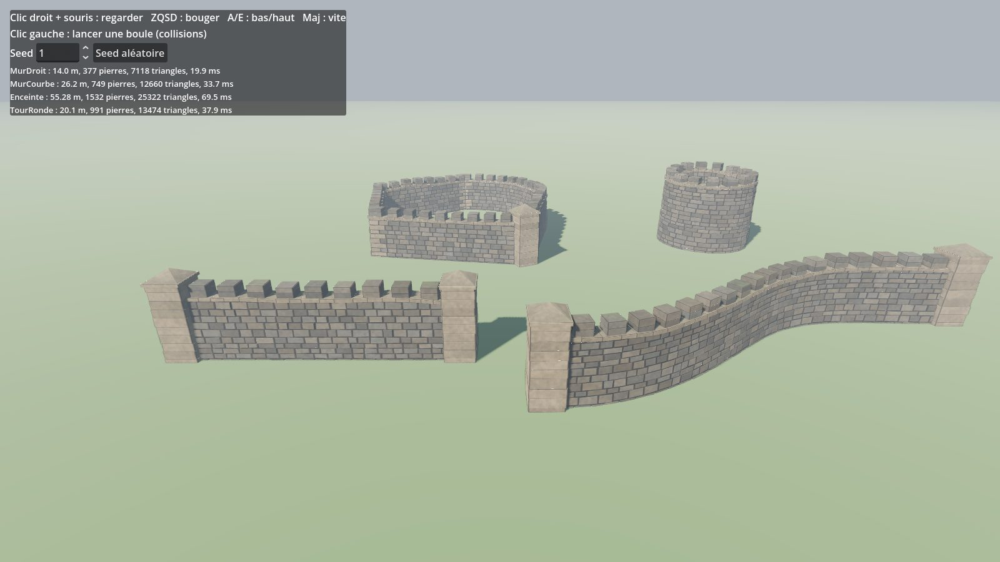

# TinyGladeLike : addon Bastide pour Godot 4

**Bastide** est un addon Godot 4 de construction procédurale « toujours belle », inspiré de Tiny Glade : on trace grossièrement, des règles corrigent et décorent.



État : **étape 1 terminée** (murs procéduraux sur Path3D). Prochaines étapes : ouvertures et hauteur variable, bâtiments sur contour, toits, styles, mode kit. L'architecture complète est décrite dans le document de conception du projet.

Version cible : **Godot 4.7.2** (fonctionne avec Forward+ et Compatibilité).

## Lancer la démo

1. Ouvre Godot 4.7.2, clique sur **Importer**, et choisis le fichier `project.godot` de ce dépôt.
2. Ouvre la scène `demos/01_wall/wall_demo.tscn` (c'est aussi la scène principale).
3. **Dans l'éditeur** : sélectionne un mur (par exemple `Murs/MurCourbe`), puis déplace ses points avec les outils de Path3D dans la barre du viewport. Le mur se régénère en direct.
4. **En jeu** : appuie sur **F5** (ou F6 pour la scène courante).
   - Clic droit maintenu + souris : regarder
   - ZQSD (ou WASD) : se déplacer, A/E : descendre/monter, Maj : plus vite
   - Clic gauche : lancer une boule pour tester les collisions
   - Le champ « Seed » change la variation de tous les murs

## Utiliser les murs

- **Ajouter un mur** : ajoute un nœud `BastideWall` (il hérite de `Path3D`), puis clique pour poser des points.
- **Angle net** : un point sans poignées. **Courbe** : tire les poignées du point (Maj + glisser dans l'outil de Path3D).
- **Enceinte fermée** : dans l'inspecteur, ouvre la `Curve3D` du mur et coche `closed`.
- **Variation** : change `seed`, ou clique sur le bouton **Nouvelle seed**. Même seed = même mur, au caillou près.
- **Hauteur** : `height` (0 = hauteur du style).
- **Style** : le fichier `addons/bastide/styles/presets/medieval_stone.tres` est partagé par tous les murs de la démo. Ouvre-le et modifie un paramètre (épaisseur, taille des pierres, créneaux, couleurs…) : tous les murs se mettent à jour. Pour un style à part, clique droit sur le style dans l'inspecteur et choisis **Rendre unique**.
- **Collisions** : générées automatiquement (désactivables dans le groupe « Collisions »).

Les meshes générés ne sont pas enregistrés dans la scène : le `.tscn` ne contient que le tracé, le style et la seed, et tout est régénéré au chargement.

## Les règles « toujours beau » de l'étape 1

- Les points trop proches sont fusionnés, les demi-tours parasites supprimés.
- Les créneaux sont répartis en nombre entier sur chaque tronçon, légèrement étirés si besoin : jamais de demi-merlon au bout d'un mur.
- Au-delà de 25° de virage, le point devient un angle net avec chaînage de pierres d'angle ; au-delà de 70°, un pilier est inséré dans l'angle.
- Les murs ouverts se terminent par des piliers.
- Le sommet ondule doucement (bruit borné par le style), en restant continu tout le long et en se refermant sans saut sur les enceintes.
- Prolonger un mur ne rebrasse pas ce qui existe déjà : les variations dépendent de la position le long du mur.

## Intégrer l'addon dans un autre jeu

Copie le dossier `addons/bastide/` dans ton projet, puis active **Bastide** dans *Projet > Paramètres du projet > Extensions*. Les dossiers `demos/`, `tests/`, `tools/` et `docs/` ne servent qu'au développement.

Pour construire un mur depuis du code (par exemple pour un futur mode construction en jeu) :

```gdscript
var wall := BastideWall.new()
add_child(wall)
wall.set_points(PackedVector3Array([Vector3(0, 0, 0), Vector3(8, 0, 0), Vector3(8, 0, 6)]))
```

## Tests

Les tests du cœur de l'addon tournent sans affichage :

```
godot --headless --path . -s tests/run_core_tests.gd
```

Sous Windows, remplace `godot` par le chemin de ton exécutable, par exemple `C:\Users\timot\Documents\Godot\Godot_v4.7.2-stable_win64.exe`.

## Organisation

```
addons/bastide/
  core/        logique pure, sans nœuds (utilisable sur un thread, en jeu, dans les tests)
    random/      hasard déterministe (seed + position)
    geometry/    outils de polylignes
    rules/       assainissement du tracé, répartition « pile »
    generators/  WallSpec → WallLayout (le plan sémantique)
    layout/      le plan : tronçons, piliers, pierres, chaperon, merlons
    backends/    plan → géométrie (procedural/ aujourd'hui, kit/ à l'étape 6)
    mesh/        construction des meshes multi-matériaux
  styles/      Resources de style et presets
  nodes/       nœuds @tool (BastideWall) et pose du résultat dans la scène
  shaders/     shader pierre procédural (aucune texture)
demos/         une scène de démo par étape
tests/         tests headless du core
tools/         scripts de développement (génération de la scène de démo, captures)
```
