# TinyGladeLike : addon Bastide pour Godot 4

**Bastide** est un addon Godot 4 de construction procédurale « toujours belle », inspiré de Tiny Glade : on trace grossièrement, des règles corrigent et décorent.

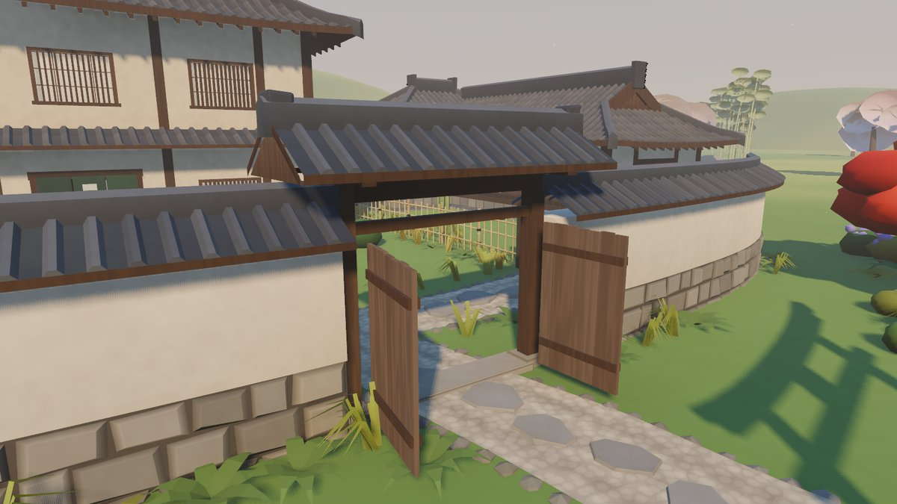

État : **jardins d'eau** (étangs tracés à la souris, creusés dans le relief, avec koï, nénuphars, iris, rochers moussus, ponts arqués et sources chaudes), après les **forêts et arbres d'Onsen** (grands arbres à couronnes peintes, outil Forêt, sous-bois), après l'**étape 6** (terrasses de bois et engawa le long des maisons, portails qui s'ouvrent tout seuls dans les murets là où passe un chemin), après l'étape 5 (décor japonais de campagne : chemins de gravier ratissé et pas japonais qui rejoignent les portes, torii, lanternes de pierre, muret de pierres sèches, clôture de bambou, massifs, arbres et jardin qui pousse tout seul), l'étape 4 (construction en jeu à la souris : on dessine murets et maisons soi-même, comme dans Tiny Glade), l'étape 3 (styles « médiéval pierre » et « japonais traditionnel bois »), l'étape 2 (bâtiments sur contour avec toits calculés) et l'étape 1 (murs procéduraux sur Path3D). Prochaine étape : mode kit (pièces .glb d'un artiste). L'architecture complète est décrite dans le document de conception du projet.

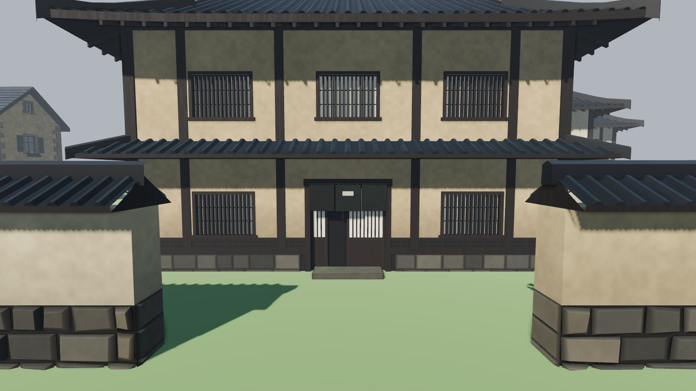

Version cible : **Godot 4.7.2** (fonctionne avec Forward+ et Compatibilité).

## Lancer la démo

1. Sur GitHub, bouton vert **Code > Download ZIP**, puis décompresse le dossier où tu veux.
2. Ouvre Godot 4.7.2, clique sur **Importer**, et choisis le fichier `project.godot` du dossier décompressé, puis **Importer et modifier**.
3. Appuie sur **F5** : la démo de construction en jeu (`demos/04_runtime/runtime_demo.tscn`) se lance. Voir « Construire en jeu » juste en dessous.
4. Terrasses et portails dans l'éditeur : `demos/06_terraces/terrace_demo.tscn` (ouvre-le, **F6** pour s'y promener ; déplace un point du chemin à travers le muret, ou une terrasse près d'une maison). Le jardin japonais : `demos/05_garden/garden_demo.tscn` (ouvre-le, **F6** pour s'y promener, ou sélectionne un chemin, une clôture ou un massif et déplace ses points : tout se recalcule, plantes comprises).
5. Les démos précédentes : `demos/03_styles/styles_demo.tscn` (le même hameau en médiéval et en japonais), `demos/02_building/building_demo.tscn` (bâtiments) et `demos/01_wall/wall_demo.tscn` (murs). Ouvre-les puis **F6**. Leurs commandes :
   - Clic droit maintenu + souris : regarder
   - ZQSD (ou WASD) : se déplacer, A/E : descendre/monter, Maj : plus vite
   - Clic gauche : lancer une boule pour tester les collisions
   - En haut à gauche (démo des styles) : **Côte à côte**, **Tout médiéval**, **Tout japonais**, **Inverser** changent le style de chaque hameau d'un coup ; **Seed** fait varier les deux hameaux pareil
6. **Dans l'éditeur** : ouvre `styles_demo.tscn` ou `building_demo.tscn`, sélectionne un bâtiment (par exemple `Batiments/FermeEnL`), puis déplace ses points avec les outils de Path3D dans la barre du viewport. Murs, fenêtres et toit se recalculent en direct.

## Construire en jeu (étape 4)

Au lancement, la caméra descend doucement vers un petit hameau qui sort de terre, maison après maison. Ensuite, c'est toi qui construis.

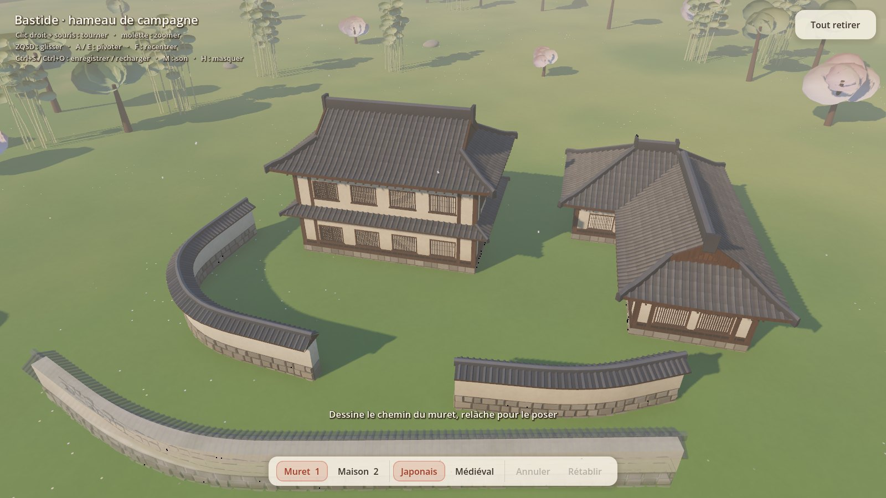

- **Muret** (touche **1**) : maintiens le clic gauche et dessine un chemin au sol. Le muret pousse en direct, en fantôme, pendant que tu dessines ; ton tracé tremblant est simplifié puis lissé. Relâche : il devient solide, un petit nuage de poussière se soulève et un « toc » de bois se fait entendre. Reviens près du point de départ pour fermer une enceinte.
- **Maison** (touche **2**) : maintiens le clic et tire un rectangle (dimensions arrondies au demi-mètre, 4 m minimum). **Tire-le par-dessus une maison existante pour l'agrandir** : elle devient une maison en L, en T ou en U, avec son toit recalculé ; le nouveau rectangle s'aligne tout seul sur elle.
- **Retoucher** : clique sur une structure pour la sélectionner (un liseré doré l'entoure). Des poignées apparaissent : tire un angle de maison (il reste d'équerre quand tu passes près de l'angle droit), tire le milieu d'un côté pour pousser tout le mur, ou tire un point de muret pour le courber. Clic droit sur une poignée : retirer ce point.
- **Sélection** : **+ / −** (ou Page haut / Page bas) changent le nombre d'étages, **R** tire une autre variation (seed), **Suppr** retire la structure (elle s'enfonce dans le sol). Les boutons du panneau font la même chose.
- **Style** : les boutons **Japonais / Médiéval** changent le style des prochaines constructions et celui de la structure sélectionnée.
- **Annuler / rétablir** : **Ctrl+Z / Ctrl+Y** (ou les boutons). Tout s'annule : tracés, agrandissements, retouches, étages, styles, suppressions.
- **Caméra** : clic droit (ou molette) maintenu + souris pour tourner autour, molette pour zoomer vers ce que vise la souris, **ZQSD** ou les flèches pour glisser, **A / E** pour pivoter, **F** pour recentrer. Plus tu t'approches, plus elle se baisse à hauteur de promeneur. Tous ses mouvements sont amortis.
- **Herbe et lumière** : une herbe haute et dense (`BastideGrass`) suit la caméra, foncée au pied et dorée aux pointes, couchée par des vagues de vent ; elle s'écarte toute seule des chemins, maisons, terrasses, murets et de l'étang, et reste plus rase en forêt. Lumière dorée de fin de journée, brume volumétrique où passent les rayons, léger flou au loin et halo doux.

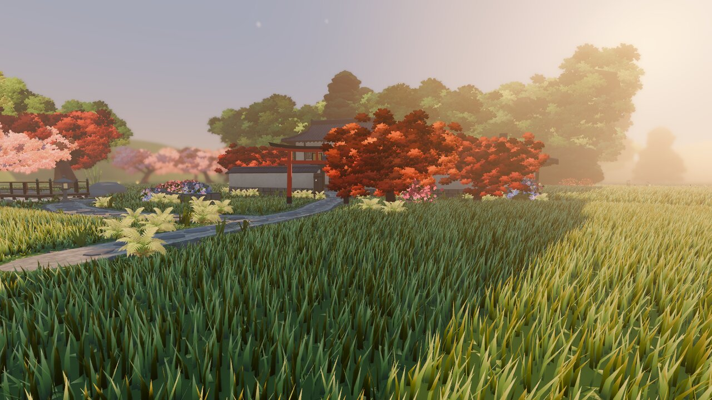

- **Jour et nuit** (touche **N**, ou le bouton **Heure**) : le temps passe (une journée en 16 minutes), du matin doré à la nuit bleutée sous la lune. **N** fait défiler les heures jusqu'au moment suivant (aube, midi, soir, nuit), **Maj + N** arrête ou relance le temps. Au crépuscule, les lanternes suspendues et de pierre s'allument : vraie lumière chaude à faible portée sur les murs et les poutres, halo doux, papier des shoji et vitres éclairés de l'intérieur. Le nombre de vraies lumières suit le niveau graphique (aucune en Bas, 6 en Moyen, 12 en Haut, 19 en Ultra, les plus proches de la caméra) ; les autres lanternes gardent leur papier lumineux et leur halo.
- **Un hameau vécu** : lierre fin plaqué contre le bois et l'enduit, avec ses tiges ; enduit blanc cassé patiné (remontées d'humidité et mousse au-dessus des fondations, coulures sous l'égout) ; fleurs des champs qui débordent sur les dalles des chemins, fougères et hautes herbes au pied des murets, touffes fleuries dans la prairie, brins d'herbe de hauteurs variées, épis et petites fleurs, mousse sur les pierres.

- **Promenade** (touche **P**) : la caméra descend à hauteur d'homme là où tu regardes. **ZQSD** pour marcher (**Maj** pour courir), clic droit + souris pour regarder. Troncs, murets et maisons arrêtent le pas, et on monte sur les terrasses. **P**, **Échap** ou molette arrière pour remonter.

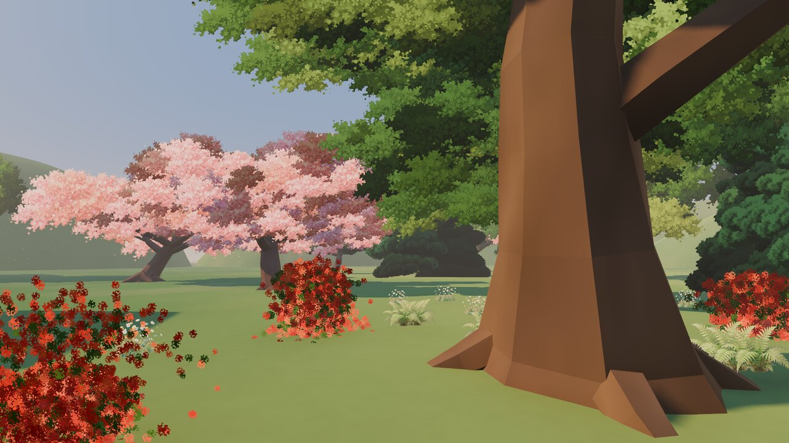
- **Divers** : **Ctrl+S / Ctrl+O** enregistrer / recharger le hameau, **M** couper le son, **H** masquer l'interface (pour les belles captures), **Échap** annuler un tracé ou désélectionner.

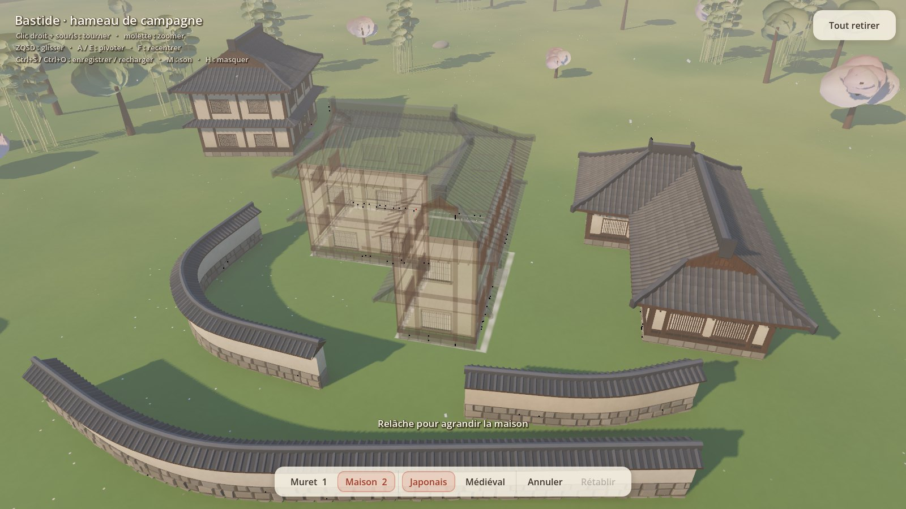

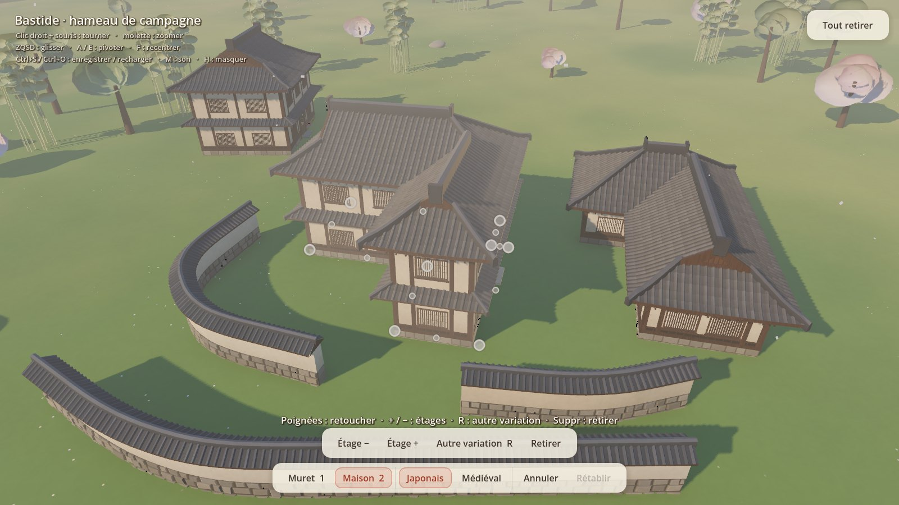

L'ambiance est entièrement procédurale, sans aucune image ni fichier son : lumière dorée de fin d'après-midi, brume légère, prairie dont l'herbe ondule au vent et parsemée de fleurs, collines au loin, cerisiers, bambous et arbres qui respirent dans le vent, un étang, des pétales qui dérivent, un vent doux synthétisé.

### Utiliser la construction en jeu dans ton jeu

Trois nœuds, dans `addons/bastide/runtime/` :

- `BastideBuildSite` : le chantier. Il possède les structures et les décrit par des « records » (de simples dictionnaires : type, points, seed, étages, style). `apply_record(id, record)` crée, modifie ou supprime (record `null`) avec les animations ; `to_data()` / `from_data()` sauvegardent et rechargent (convertible en JSON).
- `BastideBuildTool` : la souris et le clavier (tracé, fantôme, poignées, sélection, annuler). Donne-lui le chantier (`site`) et la caméra (`camera`). Il émet des signaux (`placed`, `removed`, `edited`, `hint_changed`, `selection_changed`…) pour brancher ton interface et tes sons.
- `BastideOrbitCamera` : la caméra douce (facultative : l'outil marche avec n'importe quelle `Camera3D`).

```gdscript
var site := BastideBuildSite.new()
add_child(site)
var tool := BastideBuildTool.new()
tool.site = site
tool.camera = $Camera3D
tool.style = load("res://addons/bastide/styles/presets/japanese_wood.tres")
add_child(tool)
```

Les structures posées ont leurs collisions sur la couche 1 (`site.structure_layer`). Par défaut on construit sur un plan horizontal (`tool.ground_height`) ; pour un terrain en relief, mets sa couche de collision dans `tool.ground_mask`.

## Réglages graphiques et niveaux de détail

Le nœud `BastideGraphics` (« Graphismes » dans la démo) règle tout le rendu en quatre niveaux, gardés d'une partie à l'autre (`user://bastide_graphics.cfg`) :

| | Bas | Moyen | Haut | Ultra |
|---|---|---|---|---|
| Herbe (densité, étendue) | 35 %, 60 % | 60 %, 80 % | 100 % (20 brins/m², 26 m) | 120 %, 115 % |
| Ombres | 70 m, 2 cascades | 110 m | 150 m | 180 m, plus douces |
| SSAO / SSIL / brouillard volumétrique | non | SSAO | SSAO, brouillard | tout |
| Résolution 3D (FSR) | 70 % | 85 % | 100 % | 100 % |
| Anticrénelage | FXAA | FXAA | MSAA 2× | MSAA 2× |
| Distances de détail | ×0,5 | ×0,75 | ×1 | ×1,3 |
| Images/s max | 60 | 60 | 60 | écran |

- **F3** : compteur (images/s, temps carte graphique, temps des scripts, triangles, appels de dessin). Le temps des scripts est mesuré par le nœud lui-même : le moniteur `TIME_PROCESS` de Godot compte aussi l'attente de la carte graphique.
- **F4** : niveau suivant.
- Fenêtre en arrière-plan : 15 images/s, pour ne pas chauffer pour rien.

Niveaux de détail automatiques : l'herbe garde de moins en moins de brins (plus larges) avec la distance et disparaît au-delà de 120 m ; les arbres passent à une couronne allégée au-delà de 75 m, les sous-bois et fleurs disparaissent au loin ; le relief ne porte son ombre que par une grille 16 fois plus légère. Mesure couche par couche : `tools/perf_probe.gd` (voir Tests).

## Relief du terrain

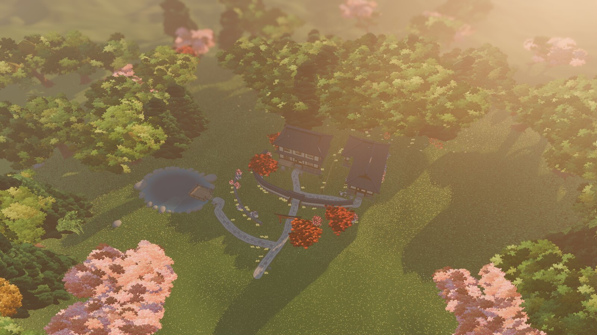
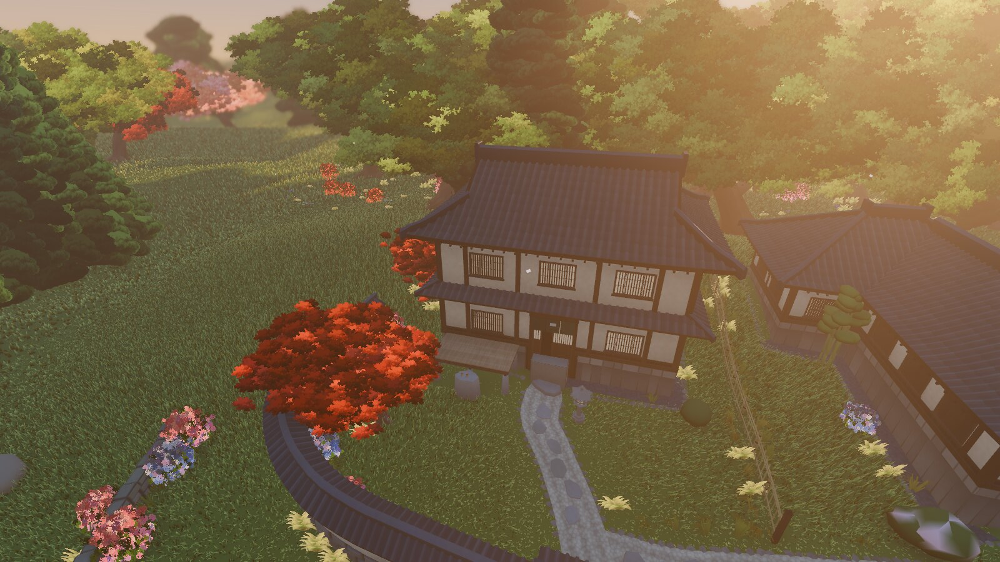

Un nœud `BastideTerrain` (collines douces, clairière presque plate, zones aplanies
`flat_zones`) donne un sol en relief avec ses collisions. Toutes les structures s'y
posent seules :

- murs, chemins et clôtures **épousent la pente** ;
- maisons, torii et terrasses restent **d'aplomb sur un socle de pierre** ;
  la terrasse se cale à la hauteur de la maison voisine (engawa) ;
- l'outil à la souris, la caméra, la promenade (P), l'herbe et le décor suivent le sol.

Les tracés restent enregistrés à plat : changer le terrain repose tout le hameau.

Sous une maison posée sur la pente, le pied descendu jusqu'au sol devient un
soubassement de pierres sèches appareillées (façon ishigaki).

## Matériaux de près

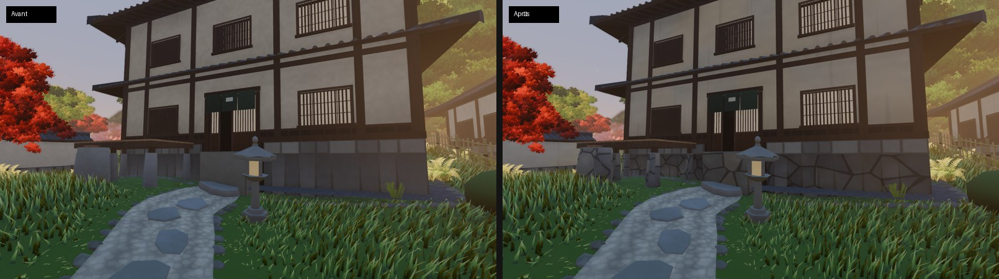

- **Tuiles** (`bastide_tile.gdshader`) : teinte qui varie d'une tuile à l'autre,
  émail satiné qui accroche la lumière rasante, coulures dans le sens de la pente,
  poussière sur les rangs et lichens jaunis par plaques. Réglages `glaze`, `streaks`,
  `dust`, `lichen_amount` ; le style par défaut est une terre cuite mate.
- **Enduit** (`plaster_amount` du shader pierre) : nuages de chaux chauds et froids,
  traces de taloche et fines coulures, sans texture.

## Silhouettes de bâtiments

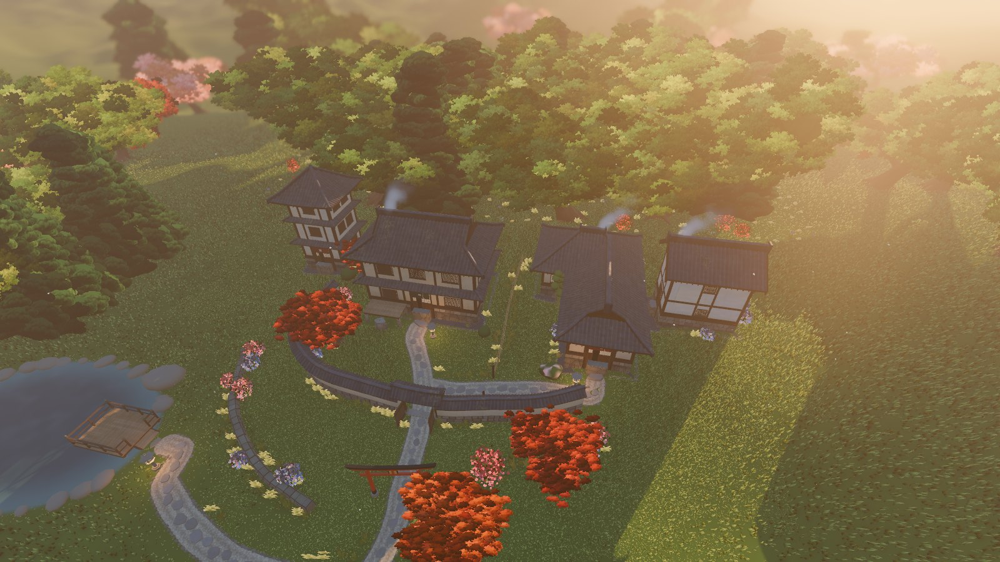

Un même style se décline en plusieurs volumes (`BastideBuilding.silhouette`,
`BastideSilhouette`) :

- **grande maison** : le volume du style ;
- **petite maison** : un seul niveau, toit qui descend bas ;
- **kura** : entrepôt aux murs blancs épais, petites fenêtres hautes, toit à pignons ;
- **tour** : trois niveaux sur une base carrée, un auvent à chaque étage, toit en pavillon.

En automatique, le tracé décide : une petite base carrée fait une tour, un petit
rectangle une petite maison ou un kura, le reste une grande maison. En jeu, **G**
(ou le bouton « Silhouette ») passe d'une silhouette à l'autre sur la maison
sélectionnée ; le choix est enregistré avec elle. Le kura et la tour ne fument pas.

## Vie du hameau

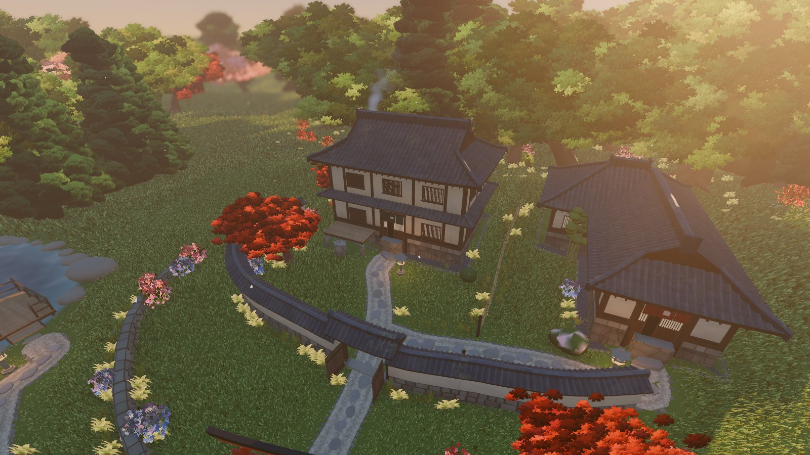

Le nœud `BastideLife` anime le hameau tout seul, à partir de ce que les
constructions exposent (points `smoke` et `lights`, posés sur le relief) :

- la fumée monte des cheminées, ou des évents sous le faîtage des maisons
  japonaises, et part avec le vent (`wind`, `smoke_share`) ;
- les lanternes de pierre des chemins sont allumées et vacillent ; seules les plus
  proches de la caméra éclairent (`max_lights`) ;
- des vols d'oiseaux tournent haut au-dessus du hameau, entre battements et planés ;
- des papillons volettent au ras de l'herbe autour de la caméra.

## Jardins d'eau

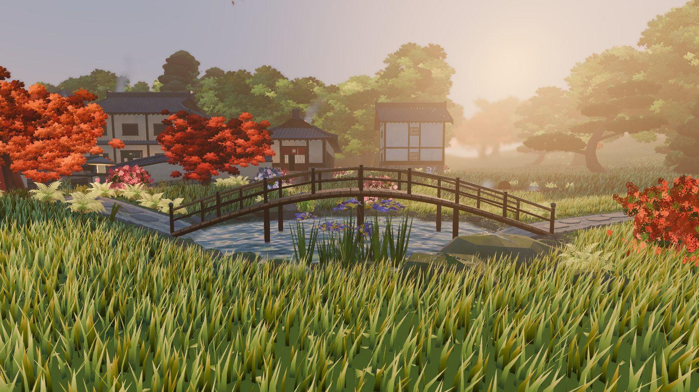

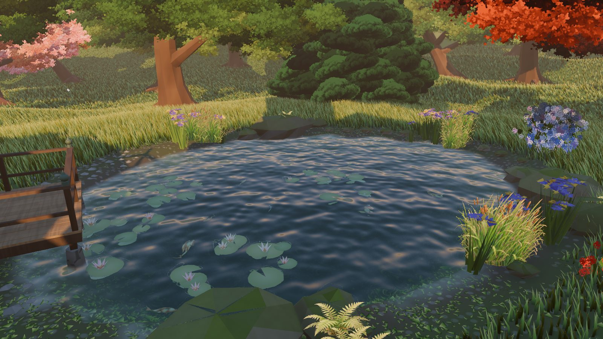

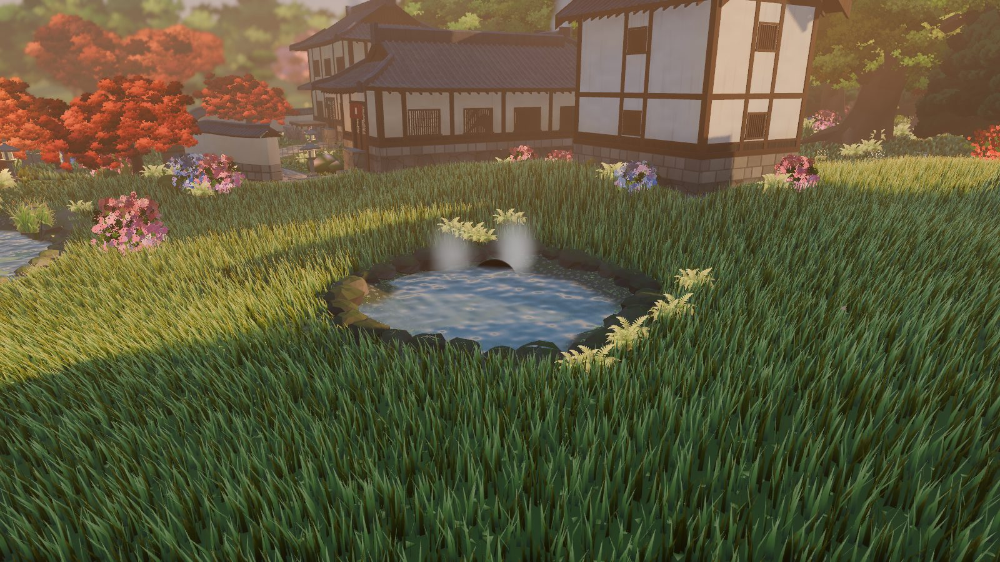

- **Étang** (touche **J**) : maintiens le clic et fais le tour d'une zone. Pendant le tracé, l'encre montre déjà la rive arrondie. Relâche : le sol se creuse et l'eau apparaît. **V** change la sorte : **étang de jardin**, **source chaude** (onsen) ou **mare sauvage**.
- **Rive naturelle** : le tracé est lissé, sans angle vif, avec une légère ondulation (deux étangs tracés pareil ne sont jamais identiques). Les tout petits étangs sont refusés, les géants ramenés à 48 m.
- **Toujours à plat** : sur une pente, l'eau reste de niveau. Le côté haut est creusé en berge douce, le côté bas reçoit une petite digue. L'eau ne fuit jamais (la rive est partout juste au-dessus).
- **L'eau** : couleur selon la vraie profondeur (on voit le fond près du bord, l'eau se ferme au milieu), réfraction, reflets du ciel au ras de l'eau, rides poussées par le vent, reflets dansants sur le fond, liseré clair contre la rive.
- **Rives** : groupes de rochers moussus posés sur les avancées de la berge (ishi-gumi), une plage de galets clairs (suhama), des pierres qui bordent le reste avec des trous. Le fond et la berge mouillée changent de couleur.
- **Vie** : iris et roseaux les pieds dans l'eau, nénuphars et lotus roses ou blancs, hortensias et azalées sur la berge, fougères au pied des rochers, et des **carpes koï** (kohaku, ogon, showa) qui tournent lentement sous la surface.
- **Ponts** : un chemin qui traverse l'eau reçoit tout seul des **pierres de gué** (passage court ou coin de l'étang), un **pont arqué** en bois avec garde-corps et giboshi (bras d'eau), ou une **passerelle en zigzag** (yatsuhashi) sur une longue traversée. Le gravier noyé du chemin disparaît.
- **Source chaude** : eau laiteuse vert d'eau, cernée de rochers sombres, vapeur qui monte. **Mare sauvage** : eau plus sombre, roseaux, beaucoup de nénuphars, peu de pierres.
- Les voisins s'adaptent : pas d'herbe dans l'eau, ni plante du jardin, ni arbre de forêt ; les structures posées autour se reposent sur la berge creusée.
- L'étang du hameau de départ est maintenant un vrai étang (il remplace l'ancien plan d'eau du décor).
- Dans l'éditeur : nœud **BastidePond** (contour fermé), réglage `pond_kind`. Il creuse le **BastideTerrain** de sa scène s'il y en a un.

## Cultures

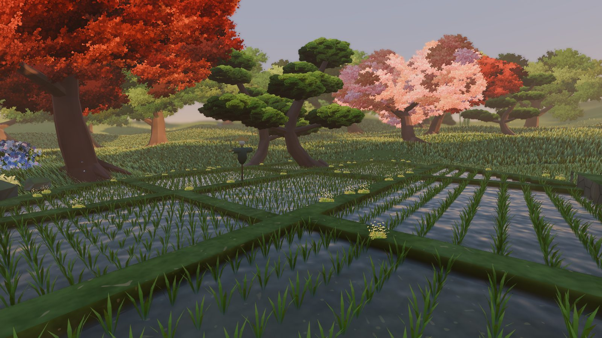

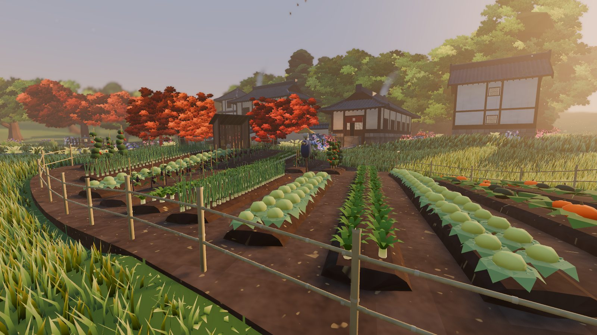

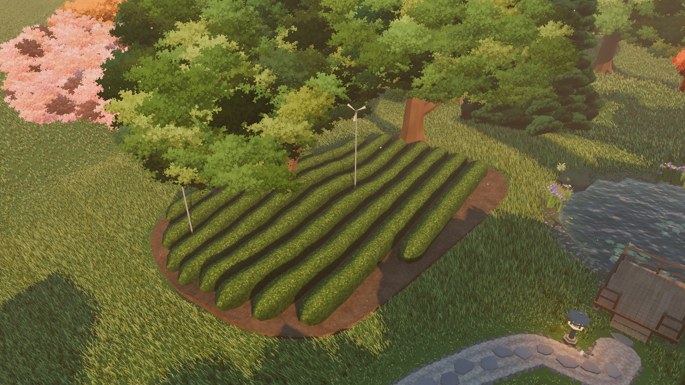

- **Champ** (touche **H**) : maintiens le clic et fais le tour d'une zone, relâche. **V** change la sorte : **potager**, **rizière** ou **champ de thé**.
- **Rangs qui suivent la pente** : sur une pente, les rangs suivent les courbes de niveau ; sur le plat, l'axe long du champ.
- **Potager** : des planches de terre surélevées, chacune avec sa culture en lignes (choux, daikon, negi, aubergines et tomates sur tuteurs, potirons), une clôture basse de bambou qui s'ouvre vers le chemin le plus proche (ou là où un chemin la traverse) et un épouvantail en kimono et chapeau de paille.
- **Rizière** : la pente est taillée en **terrasses de niveau** (tanada), retenues par des murets de pierres sèches. Chaque terrasse est une nappe d'eau peu profonde qui renvoie le ciel, bordée de levées herbues ; d'autres levées la recoupent en rizières. Le riz est repiqué en lignes. Sur le plat, un damier de rizières.
- **Thé** : de longues haies taillées en arrondi, feuillage serré avec ses jeunes pousses claires, de la paille entre les rangs et des ventilateurs antigel sur leurs mâts.
- **Le sol** est abaissé sous le champ (déblai des terrasses compris) et la terre du champ est posée par-dessus ; ses bords descendent en talus ou en muret. L'herbe, les forêts, les massifs et le jardin automatique évitent les champs ; un chemin qui traverse un potager passe entre les planches.
- Dans l'éditeur : nœud **BastideFarm** (contour fermé), réglage `farm_kind`.

## Forêts et arbres d'Onsen

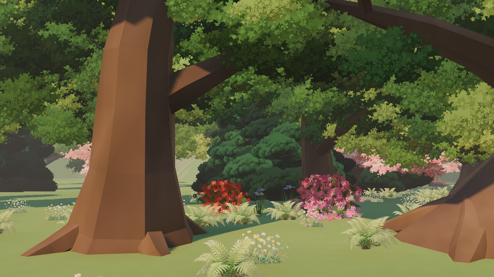

Les arbres et plantes viennent du projet « L'onsen de la colline » (même auteur) : des modèles faits par script dans Blender (couleurs par sommet), habillés comme dans Onsen. Chaque arbre garde son tronc, et sa couronne est refaite en **cartes face caméra** posées sur les boules de feuillage du modèle, texturées de touffes peintes. Elle s'éclaire en deux tons francs, avec la lumière qui traverse le bord à contre-jour. Une silhouette légère porte l'ombre.

- **Forêt** (touche **B**) : maintiens le clic et fais le tour d'une zone. Relâche : la forêt pousse. **V** change la sorte : mêlée, cèdres, chênaie, érables d'automne, cerisiers, pinède.
- Les grands arbres (chênes, hêtres, cèdres, camphriers) font **15 à 20 m**, et les érables, cerisiers et pins 10 à 12 m. On circule entre les troncs, qui ont des collisions.
- **Lisière festonnée** : plus claire au bord, plus dense au cœur.
- **Sous-bois** : fougères et buissons à l'ombre des couronnes, fleurs des champs, azalées, hortensias et iris dans les trouées.
- La forêt évite d'elle-même les maisons, terrasses, chemins, murs et portes.
- **Massifs et jardin** : leurs arbres isolés (érable, cerisier, pin taillé), leurs hortensias et leurs fougères sont maintenant ceux d'Onsen (style japonais, `kit_plants` dans le volet Garden).
- Au loin, les couronnes passent à une version à peu de cartes, et les plantes du sous-bois s'effacent.
- Dans l'éditeur : nœud **BastideForest** (contour fermé). Réglages : `forest_kind`, `tree_scale` (2 = géants de 35 m), `density`, `undergrowth`.

Les sources d'Onsen gardées pour référence (le script Blender `japan.py` qui génère les arbres, les scripts et shaders d'origine) sont dans `docs/onsen_ref/`. Les touffes peintes ont été générées avec Gemini puis détourées. Les modèles Meshy d'Onsen n'ont pas été repris.

## Terrasses et portails (étape 6)

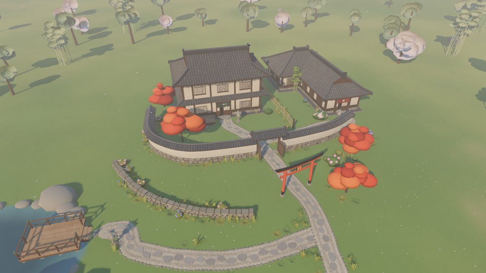

Dans la démo de construction en jeu, un sixième outil, **Terrasse** (touche **T**, ou le bouton de la barre) :

- **Contre une maison** : tire un rectangle le long d'une façade. Il s'aligne sur elle dès le premier clic, puis se colle au mur et devient un **engawa** : galerie de planches posée sur des poteaux courts et leurs pierres, de 0,9 à 2,4 m de profondeur, sans garde-corps, une grande pierre de seuil devant (parfois une paire de geta posée dessus). Il s'arrête aux angles de la maison et ne passe jamais devant la porte : il s'arrête avant, du côté le plus long.
- **Ailleurs** : une terrasse isolée, avec son garde-corps (lisse haute, boules de bronze aux angles) et quelques marches de bois **du côté de la caméra**. Au bord de l'étang, elle avance sur l'eau.
- **Retoucher** : les poignées d'angle gardent toujours un rectangle (l'angle opposé reste en place), les milieux de côtés poussent un côté. Près d'une maison, la terrasse s'y recolle.

Et sans rien faire : **un muret traversé par un chemin s'ouvre**. Dessine un chemin à travers un muret à petit toit : un portail couvert apparaît (deux poteaux sur leurs pierres, une poutre, un petit toit de tuiles plus haut et plus large que celui du mur, des vantaux de planches grands ouverts contre le mur, un seuil de pierre). En style médiéval, ce sont deux piliers plus hauts que les autres et un arc de claveaux. Annule le chemin : le portail se referme.

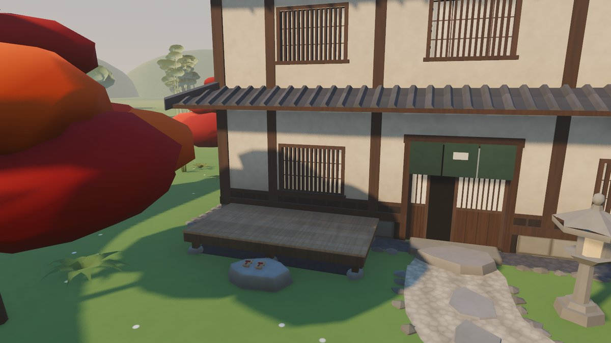

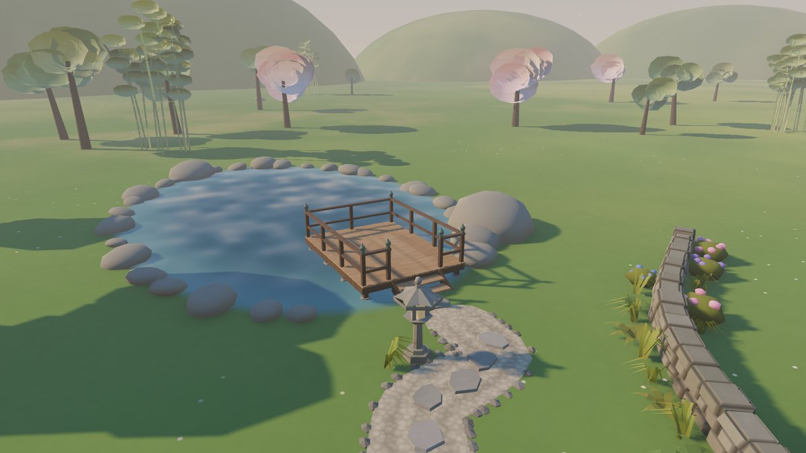

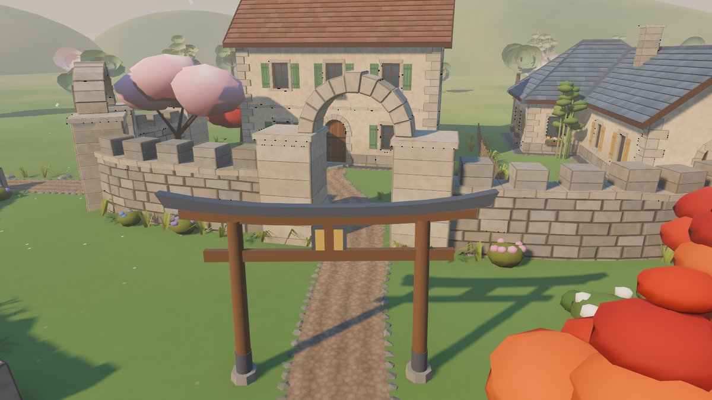

### Dans l'éditeur

- `BastideTerrace` (hérite de `Path3D`) : les points de la courbe donnent l'emprise, toujours redressée en rectangle (axe du premier côté). `entry_side` choisit le côté des marches (-1 = automatique), `height` la hauteur du plancher (0 = style).
- `BastideWall` s'ouvre tout seul pour les `BastidePath` qui le traversent (`open_for_paths`, coché par défaut). La forme du portail est dans le volet **Wall** du style, groupe **Portails** : `gate_kind` (Auto, Couvert, Arc, Piliers), bois, vantaux, passage minimal.
- Les couleurs, la hauteur, le garde-corps, les giboshi et les petits détails des terrasses sont dans le volet **Garden**, groupe **Terrasses**.

En jeu, nouveau record `"terrace"` (quatre angles, `entry` facultatif). Les marches d'une terrasse sont déclarées comme une porte : un chemin qui arrive près d'elles les rejoint, avec sa lanterne.

## Les règles « toujours beau » de l'étape 6

- Une terrasse est toujours un rectangle, au quart de mètre ; ses planches ont une largeur régulière, des joints décalés d'une planche à l'autre, et courent dans le sens de la façade pour un engawa (du plus long côté sinon). Poteaux en nombre entier, jamais plus de 1,8 m entre deux, chacun sur sa pierre.
- Un engawa est collé à la façade (6 cm de jour pour le soubassement), ne dépasse pas les angles, laisse 55 cm de part et d'autre de la porte. Ses marches (sa pierre de seuil) donnent toujours à l'opposé de la maison.
- Les marches d'une terrasse isolée ont toutes la même hauteur (environ 17 cm) ; le garde-corps s'ouvre pile à leur droit.
- Un portail est centré sur le chemin, assez large même en biais (2 m de passage libre au moins entre les montants), et deux chemins voisins partagent un seul portail. Près du bout d'un mur, on ne laisse jamais un bout de mur ridicule.
- Le petit toit du portail est toujours au-dessus de ceux du mur ; l'arc médiéval naît sur la dalle des piliers, avec un nombre impair de claveaux et une clé au sommet.
- Aucune plante sous une terrasse ; pas de pas japonais, de bordure ni de lanterne qui la chevauchent.
- Les structures se voient dans le bon ordre : maisons, puis terrasses (elles se calent sur les maisons), puis chemins (ils rejoignent portes et marches), puis murs (ils s'ouvrent pour les chemins), puis clôtures et massifs, puis le jardin. Retirer une structure prévient aussi ses voisins (un portail se referme quand on annule son chemin).

## Le jardin japonais (étape 5)

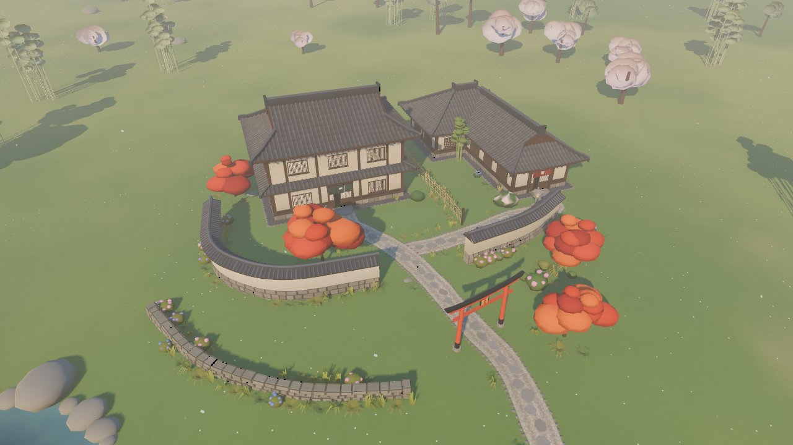

Dans la démo de construction en jeu, cinq outils (touches **1 à 5**, ou les boutons de la barre) :

- **Muret** (1) : trois variantes, avec **V** ou les boutons qui apparaissent au-dessus de la barre : *muret à petit toit* (celui de l'étape 4), *pierres sèches* (muret bas de pierres rondes, moussu sur le dessus), *bambou* (clôture à claire-voie, liens de corde noire).
- **Maison** (2) : comme avant.
- **Chemin** (3) : dessine-le au sol. Pars d'une porte (ou finis près d'elle) : il la rejoint tout seul, de face, sur une grande pierre de seuil, et une lanterne de pierre t'accueille. Finis près d'un autre chemin : il s'y raccorde.
- **Torii** (4) : un torii fantôme suit la souris ; approche-le d'un chemin, il se met en travers, centré, à la bonne largeur. Clic : il est posé (on peut en poser plusieurs à la suite).
- **Plantes** (5) : dessine un massif (buissons taillés, hortensias, fougères, herbes, un petit arbre de temps en temps) ou **clique** pour planter un arbre (érable rouge, cerisier ou pin taillé, selon la variation ; **R** en tire un autre).

Et sans rien faire : **le jardin pousse tout seul**. Bande de galets au pied des maisons, grosses touffes aux angles, petit érable ou bambous dans les angles rentrants, plantes basses le long des façades, herbes et fougères au pied des murs et des clôtures, touffes au bord des chemins. Il suit chaque retouche.

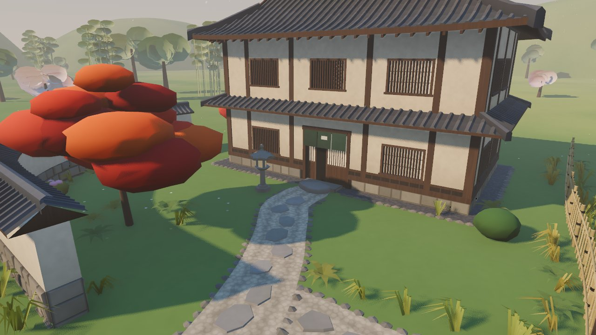

### Dans l'éditeur

Cinq nouveaux nœuds (ils héritent de `Path3D`, comme les murs) :

- `BastidePath` : chemin sur sa courbe. `width` (0 = style).
- `BastideTorii` : les deux points de la courbe sont les pieds des piliers. Bouton **Aligner sur le chemin**.
- `BastideFence` : clôture basse, `variant` = pierres sèches ou bambou ; coche `closed` sur la courbe pour une enceinte.
- `BastidePlanting` : massif le long de la courbe ; une courbe d'un seul point = un arbre.
- `BastideGarden` : ajoute-le une fois dans la scène ; il décore toutes les structures autour de lui.

Ils se voient entre eux : déplace une maison, son chemin la suit jusqu'à la porte, la clôture se rouvre au bon endroit, les plantes s'écartent. Couleurs, largeur des chemins, pas japonais, lanternes, hauteur des clôtures, densité des plantes et espèces d'arbres : volet **Garden** du style. En style médiéval, le même tracé donne un chemin de terre sans lanterne, une clôture de bois et un portique de bois brun.

En jeu, le chantier (`BastideBuildSite`) crée son jardin tout seul (`auto_garden`, style `garden_style`). Nouveaux records : `"path"`, `"torii"` (deux points), `"fence"` (`variant` 0 ou 1), `"plants"` (un point = un arbre), et `door` (facultatif) sur une maison pour choisir le côté de la porte.

## Les règles « toujours beau » de l'étape 5

- Un chemin qui finit à moins de 3,6 m d'une porte la rejoint : il arrive droit sur elle sur les 2,6 derniers mètres et s'arrête sur une pierre de seuil. Près d'un autre chemin (2,2 m), il s'y raccorde ; les deux graviers se fondent (grain calculé en coordonnées monde, chaque chemin à sa hauteur au demi-centimètre près).
- Un chemin serpente doucement (bruit borné, jamais dans l'approche d'une porte), ses bords ondulent un peu, ses pas japonais vont en quinconce à un pas tranquille, sa bordure de petites pierres s'interrompt aux croisements et devant les portes.
- Une lanterne à chaque arrivée sur une porte (ou une au départ), du côté où elle ne gêne rien.
- Un torii posé à moins de 3,5 m d'un chemin s'y centre, en travers ; sa largeur suit celle du chemin (2,2 à 7 m), sa hauteur et l'épaisseur de ses piliers suivent sa largeur.
- Une clôture s'ouvre là où un chemin la traverse, assez large même en biais, avec deux poteaux (ou deux grandes pierres dressées) pour encadrer le passage. Poteaux en nombre entier sur chaque tronçon.
- Aucune plante sur un chemin, dans une maison, devant une porte, contre un pilier de torii ou à cheval sur un mur. Les plantes vont par groupes, pas en rang d'oignons, et chacune tire son allure de sa position : retoucher une maison ne fait pas repousser tout le jardin autrement.

## Les règles « toujours beau » de l'étape 4

- Le tracé à la main est simplifié (les tremblements disparaissent), puis lissé ; un long mur garde un angle franc au lieu d'un grand arrondi.
- Ce qui est en cours de tracé est un vrai mur ou une vraie maison, générés en direct sur un thread de fond, mais en fantôme : tu vois exactement ce que tu vas obtenir.
- Une maison a toujours une taille raisonnable (4 à 22 m de côté, au demi-mètre) ; un rectangle tiré sur une maison s'aligne sur elle, et l'union passe par les règles de l'étape 2 (angles redressés, toit calculé).
- Rien ne saute : apparitions qui poussent du sol, disparitions qui s'enfoncent, tassement après une retouche, caméra et aide qui changent en fondu.

## Utiliser les murs

- **Ajouter un mur** : ajoute un nœud `BastideWall` (il hérite de `Path3D`), puis clique pour poser des points.
- **Angle net** : un point sans poignées. **Courbe** : tire les poignées du point (Maj + glisser dans l'outil de Path3D).
- **Enceinte fermée** : dans l'inspecteur, ouvre la `Curve3D` du mur et coche `closed`.
- **Variation** : change `seed`, ou clique sur le bouton **Nouvelle seed**. Même seed = même mur, au caillou près.
- **Hauteur** : `height` (0 = hauteur du style).
- **Style** : le fichier `addons/bastide/styles/presets/medieval_stone.tres` est partagé par tous les murs de la démo. Ouvre-le et modifie un paramètre (épaisseur, taille des pierres, créneaux, couleurs…) : tous les murs se mettent à jour. Pour un style à part, clique droit sur le style dans l'inspecteur et choisis **Rendre unique**.
- **Collisions** : générées automatiquement (désactivables dans le groupe « Collisions »).

Les meshes générés ne sont pas enregistrés dans la scène : le `.tscn` ne contient que le tracé, le style et la seed, et tout est régénéré au chargement.

## Utiliser les bâtiments

- **Ajouter un bâtiment** : ajoute un nœud `BastideBuilding` (il hérite de `Path3D`). Une maison rectangulaire apparaît tout de suite.
- **Changer la forme** : chaque point de la courbe est un angle de la maison. Déplace les points, ajoute-en (outil « Ajouter un point ») ou supprimes-en. Le contour est toujours fermé et les poignées de courbe sont ignorées (murs droits). Les formes en L, en U, en T, en croix ou irrégulières marchent.
- **Étages** : `floors` (0 = valeur du style, 2 par défaut).
- **Toit** : `roof` = Style, Croupes (des pans de tous les côtés), Pignons (les bouts étroits des ailes deviennent des murs triangulaires) ou Irimoya (croupe en bas, petit pignon de bois en haut).
- **Porte** : automatique (au milieu de la plus longue façade sous le toit), ou choisis le côté avec `door_facade` (0 = du premier au deuxième point).
- **Variation** : `seed` ou le bouton **Nouvelle seed** : couleur du toit et des volets, teinte de l'enduit, jardinières, cheminée, pierres. Même seed = même maison.
- **Style** : voir « Changer de style » plus bas. Les réglages des bâtiments et des toits sont dans le fichier du style, volets **Building** (construction, étages, fenêtres, porte, ossature bois, couleurs) et **Roof** (forme, pente, débord, tuiles, faîtage, couleurs possibles, cheminée).
- **Collisions** : murs, pignons, toit et cheminée (désactivables dans le groupe « Collisions »).

## Changer de style

Un style est une Resource (`BastideStyle`, fichier `.tres`) qui décrit **tout** : proportions, couleurs, matériaux et règles (créneaux ou petit toit de tuiles, fenêtres à croisillons ou à claire-voie, porte cintrée ou coulissante, toit à pignons ou irimoya…). Changer le style d'un nœud change donc son architecture, pas seulement ses couleurs.

- **En un clic** : sélectionne un mur ou un bâtiment (ou plusieurs à la fois), puis dans l'inspecteur choisis un style dans la liste **Style Preset** de l'inspecteur. Tout style `.tres` rangé dans `addons/bastide/styles/presets/` apparaît dans cette liste.
- **Glisser-déposer** : tu peux aussi glisser un `.tres` de style depuis le système de fichiers sur la propriété `style`.
- **Créer ton style** : duplique `japanese_wood.tres` (clic droit > Dupliquer) dans le dossier des presets, renomme-le (`display_name`), puis règle ses volets **Wall**, **Building**, **Roof** et **Garden**.
- **Depuis du code** : `node.style = load("res://addons/bastide/styles/presets/japanese_wood.tres")`.

Les deux styles livrés :

| | Médiéval pierre | Japonais traditionnel bois |
|---|---|---|
| Murs | pierres apparentes, chaperon, créneaux, piliers | soubassement de pierres, enduit de terre, petit toit de tuiles rondes |
| Façades | enduit, chaînes d'angle et bandeaux de pierre | ossature bois apparente (poteaux tous les 1,8 m environ, poutres), bardage bas en bois brûlé |
| Fenêtres | croisillons, encadrement de pierre, volets, jardinières | claire-voie de lattes devant un écran de papier quadrillé |
| Porte | porte en planches cintrée à claveaux | porte coulissante à deux vantaux, pierre de seuil, noren (rideau) selon la seed |
| Toit | tuiles plates, pignons, cheminée | irimoya (croupe en bas, petit pignon de bois en haut), tuiles rondes, bords relevés, faîtage maçonné à épis, chevrons apparents, auvent entre les étages |

Le volet **Garden** (chemins, clôtures, végétation, torii, lanternes) habille les abords : voir l'étape 5.

## Les règles « toujours beau » de l'étape 3

- Le style choisit les pièces, le plan sémantique reste le même : même contour, mêmes travées, même porte, quel que soit le style. Les deux hameaux de la démo sont donc « la même ville » dans deux architectures.
- Ossature bois : un poteau entre deux travées, jamais à travers une fenêtre ni collé à un angle ; poteaux réguliers sur les façades aveugles.
- Toit irimoya : la croupe basse fait le tour du bâtiment, les petits pignons ne se posent que sur les bouts étroits des ailes ; un plan carré garde une croupe simple. Si le contour ne s'y prête pas, repli sur des croupes, jamais de trou.
- Bords relevés : seul le débord se relève (au-delà de l'aplomb des murs), un peu plus aux angles, et la déformation ne dépend que de la position : les pans restent jointifs et le dessous du toit repose toujours sur les murs.
- Auvent seulement à partir de deux étages ; noren tiré par la seed.
- Allègement : les petites pièces de bois sont dessinées sans biseau invisible, les faces cachées (contre le mur, sous le bloc du dessus) ne sont plus émises et les tuiles plates n'ont plus qu'un ressaut par rang. Une maison de 10 × 6 m passe de ~33 000 à ~19 000 triangles, le manoir en U de 3 étages de ~67 000 à ~38 000, sans différence visible.

## Les règles « toujours beau » de l'étape 2

- Le contour est assaini : points trop proches fusionnés, points alignés retirés, pointes trop aiguës supprimées, contour croisé remplacé par son enveloppe.
- Un contour presque orthogonal (chaque côté à moins de 18° d'un angle droit) est **redressé** : tu traces à la main, les angles deviennent exactement droits. Un contour franchement irrégulier est gardé tel quel.
- Le toit est calculé par **squelette droit** : chaque pan a la même pente, les faîtages, arêtiers et noues tombent juste, quelle que soit la forme. Un carré donne un toit en pavillon, un rectangle un faîtage.
- En mode pignons, seuls les bouts étroits des ailes deviennent des pignons (jamais deux pignons côte à côte). Si un calcul échoue sur un contour extrême, on se replie sur des croupes, puis sur un toit plat : jamais de trou.
- Le toit déborde des murs du même débord partout, et son dessous repose pile sur le haut des murs. Les murs pignons suivent exactement la pente.
- Fenêtres en travées régulières, centrées, loin des angles, alignées d'un étage à l'autre. La porte est toujours dans la travée du milieu (nombre de travées impair sur sa façade), et jamais sur un pignon si c'est évitable.
- Les volets ne sont posés que s'ils ont la place de s'ouvrir ; une petite fenêtre est ajoutée dans les pignons assez hauts.
- Tuiles en rangs décalés avec ressaut, tuiles faîtières sur les faîtages et arêtiers, gouttière dans les noues, planches de rive sur les pignons.

## Les règles « toujours beau » de l'étape 1

- Les points trop proches sont fusionnés, les demi-tours parasites supprimés.
- Les créneaux sont répartis en nombre entier sur chaque tronçon, légèrement étirés si besoin : jamais de demi-merlon au bout d'un mur.
- Au-delà de 25° de virage, le point devient un angle net avec chaînage de pierres d'angle ; au-delà de 70°, un pilier est inséré dans l'angle.
- Les murs ouverts se terminent par des piliers.
- Le sommet ondule doucement (bruit borné par le style), en restant continu tout le long et en se refermant sans saut sur les enceintes.
- Prolonger un mur ne rebrasse pas ce qui existe déjà : les variations dépendent de la position le long du mur.

## Intégrer l'addon dans un autre jeu

Copie le dossier `addons/bastide/` dans ton projet, puis active **Bastide** dans *Projet > Paramètres du projet > Extensions*. Les dossiers `demos/`, `tests/`, `tools/` et `docs/` ne servent qu'au développement.

Pour construire depuis du code (voir aussi « Construire en jeu » plus haut) :

```gdscript
var wall := BastideWall.new()
add_child(wall)
wall.set_points(PackedVector3Array([Vector3(0, 0, 0), Vector3(8, 0, 0), Vector3(8, 0, 6)]))

var house := BastideBuilding.new()
add_child(house)
house.set_footprint(PackedVector3Array([Vector3(0, 0, 0), Vector3(10, 0, 0), Vector3(10, 0, 6), Vector3(0, 0, 6)]))

var path := BastidePath.new()      # rejoint la porte de la maison tout seul
add_child(path)
path.set_points(PackedVector3Array([Vector3(5, 0, 18), Vector3(5, 0, 8)]))

var garden := BastideGarden.new()  # galets et plantes autour de tout
add_child(garden)
```

## Tests

Les tests du cœur de l'addon (367 vérifications, dont les champs (planches, terrasses, haies de thé), dont les étangs (forme, creusement, ponts), dont les arbres d'Onsen et les forêts, dont les portails et les terrasses, dont les règles du jardin, dont le squelette droit sur 900 contours aléatoires et le toit irimoya sur 400) tournent sans affichage :

```
godot --headless --path . -s tests/run_core_tests.gd
```

La construction en jeu a sa propre partie scriptée : elle simule la vraie souris (tracer un muret, tirer une maison, l'agrandir en L, cliquer, tirer une poignée, annuler, rétablir, recharger), vérifie le résultat et prend des captures. Elle a besoin d'une fenêtre :

```
godot --path . -s tools/runtime_play.gd -- <dossier_des_captures>
```

Le décor de l'étape 5 a la sienne (chemin tracé jusqu'à une porte, torii aimanté, clôture ouverte, massif, arbre, annulations) :

```
godot --path . -s tools/garden_play.gd -- <dossier_des_captures>
```

Et celui de l'étape 6 (engawa tiré contre une maison, terrasse isolée, chemin qui ouvre un second portail, passage en médiéval, annulations) :

```
godot --path . -s tools/terrace_play.gd -- <dossier_des_captures>
```

Et celle des forêts (forêt du hameau, vues au cœur de la forêt, forêt d'érables tracée à la souris, autres sortes, annulation) :

```
godot --path . -s tools/forest_play.gd -- <dossier_des_captures>
```

Et celle des jardins d'eau (étang du hameau, étang tracé avec la touche J, chemin qui reçoit son pont, source chaude, annuler, rétablir, retirer et sol qui se rebouche). Elle marche aussi en `--headless` pour les vérifications seules :

```
godot --path . -s tools/pond_play.gd -- <dossier_des_captures>
```

Et celle des cultures (potager tracé avec la touche H, rizière avec V, sol abaissé, annuler, rétablir, retirer) :

```
godot --path . -s tools/farm_play.gd -- <dossier_des_captures>
```

Sous Windows, remplace `godot` par le chemin de ton exécutable, par exemple `C:\Users\timot\Documents\Godot\Godot_v4.7.2-stable_win64.exe`.

## Organisation

```
addons/bastide/
  core/        logique pure, sans nœuds (utilisable sur un thread, en jeu, dans les tests)
    random/      hasard déterministe (seed + position)
    geometry/    polylignes, polygones, squelette droit pondéré (toits), tracés à main levée
    rules/       assainissement du tracé et du contour, répartition « pile », règles du jardin et des terrasses
    garden/      le voisinage vu par le décor (portes, chemins, murs…)
    generators/  Spec → Layout : murs, bâtiments, toits
    layout/      les plans sémantiques (mur, bâtiment, toit)
    backends/    plan → géométrie (procedural/ : murs et portails, bâtiments, toits, chemins, torii, clôtures, plantes, terrasses)
    kit/         kit nature (arbres d'Onsen à couronnes peintes) et forêts
    water/       jardins d'eau : forme de la rive, niveau, creusement du relief, rochers, plantes, koï, ponts
    farm/        cultures : grille de terre, planches et légumes, rizières en terrasses, haies de thé
    terrain/     relief (grille de hauteurs, plans d'eau) et pose des structures dessus
    mesh/        construction des meshes multi-matériaux
  styles/      Resources de style (mur, bâtiment, toit, abords) et presets
  nodes/       nœuds @tool (BastideWall, BastideBuilding, BastidePath, BastideTorii, BastideFence,
               BastidePlanting, BastideTerrace, BastideForest, BastidePond, BastideFarm, BastideGarden, BastideTerrain,
               base commune BastideStructure)
  kit/nature/  modèles .glb des arbres et plantes d'Onsen, touffes peintes
  runtime/     construction en jeu (chantier, outil de tracé, caméra douce, poignées)
  shaders/     shaders pierre, bois, gravier ratissé, feuillage, écorce, couronnes peintes, eau et koï, terre des cultures
demos/         une scène de démo par étape
tests/         tests headless du core
tools/         scripts de développement (génération de la scène de démo, captures)
docs/onsen_ref/ sources d'Onsen gardées pour référence (ignorées par Godot)
```
