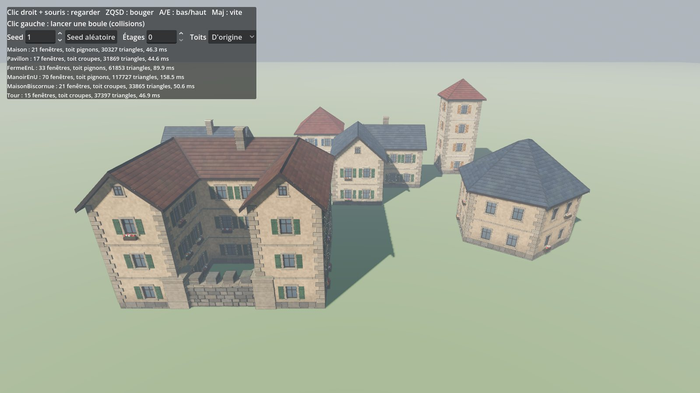

# TinyGladeLike : addon Bastide pour Godot 4

**Bastide** est un addon Godot 4 de construction procédurale « toujours belle », inspiré de Tiny Glade : on trace grossièrement, des règles corrigent et décorent.



État : **étape 2 terminée** (bâtiments sur contour avec toits calculés), après l'étape 1 (murs procéduraux sur Path3D). Prochaines étapes : styles interchangeables (médiéval / japonais), puis mode kit. L'architecture complète est décrite dans le document de conception du projet.

Version cible : **Godot 4.7.2** (fonctionne avec Forward+ et Compatibilité).

## Lancer la démo

1. Sur GitHub, bouton vert **Code > Download ZIP**, puis décompresse le dossier où tu veux.
2. Ouvre Godot 4.7.2, clique sur **Importer**, et choisis le fichier `project.godot` du dossier décompressé, puis **Importer et modifier**.
3. Appuie sur **F5** : la démo des bâtiments (`demos/02_building/building_demo.tscn`) se lance. La démo des murs est dans `demos/01_wall/wall_demo.tscn` (ouvre-la puis **F6**).
   - Clic droit maintenu + souris : regarder
   - ZQSD (ou WASD) : se déplacer, A/E : descendre/monter, Maj : plus vite
   - Clic gauche : lancer une boule pour tester les collisions
   - En haut à gauche : **Seed** (variation de tous les bâtiments), **Étages**, **Toits** (croupes ou pignons)
4. **Dans l'éditeur** : ouvre `building_demo.tscn`, sélectionne un bâtiment (par exemple `Batiments/FermeEnL`), puis déplace ses points avec les outils de Path3D dans la barre du viewport. Murs, fenêtres et toit se recalculent en direct.

## Utiliser les murs

- **Ajouter un mur** : ajoute un nœud `BastideWall` (il hérite de `Path3D`), puis clique pour poser des points.
- **Angle net** : un point sans poignées. **Courbe** : tire les poignées du point (Maj + glisser dans l'outil de Path3D).
- **Enceinte fermée** : dans l'inspecteur, ouvre la `Curve3D` du mur et coche `closed`.
- **Variation** : change `seed`, ou clique sur le bouton **Nouvelle seed**. Même seed = même mur, au caillou près.
- **Hauteur** : `height` (0 = hauteur du style).
- **Style** : le fichier `addons/bastide/styles/presets/medieval_stone.tres` est partagé par tous les murs de la démo. Ouvre-le et modifie un paramètre (épaisseur, taille des pierres, créneaux, couleurs…) : tous les murs se mettent à jour. Pour un style à part, clique droit sur le style dans l'inspecteur et choisis **Rendre unique**.
- **Collisions** : générées automatiquement (désactivables dans le groupe « Collisions »).

Les meshes générés ne sont pas enregistrés dans la scène : le `.tscn` ne contient que le tracé, le style et la seed, et tout est régénéré au chargement.

## Utiliser les bâtiments

- **Ajouter un bâtiment** : ajoute un nœud `BastideBuilding` (il hérite de `Path3D`). Une maison rectangulaire apparaît tout de suite.
- **Changer la forme** : chaque point de la courbe est un angle de la maison. Déplace les points, ajoute-en (outil « Ajouter un point ») ou supprimes-en. Le contour est toujours fermé et les poignées de courbe sont ignorées (murs droits). Les formes en L, en U, en T, en croix ou irrégulières marchent.
- **Étages** : `floors` (0 = valeur du style, 2 par défaut).
- **Toit** : `roof` = Style, Croupes (des pans de tous les côtés) ou Pignons (les bouts étroits des ailes deviennent des murs triangulaires).
- **Porte** : automatique (au milieu de la plus longue façade sous le toit), ou choisis le côté avec `door_facade` (0 = du premier au deuxième point).
- **Variation** : `seed` ou le bouton **Nouvelle seed** : couleur du toit et des volets, teinte de l'enduit, jardinières, cheminée, pierres. Même seed = même maison.
- **Style** : les réglages des bâtiments et des toits sont dans le même fichier `medieval_stone.tres`, volets **Building** (étages, épaisseur, fenêtres, porte, couleurs) et **Roof** (pente, débord, tuiles, couleurs possibles, cheminée).
- **Collisions** : murs, pignons, toit et cheminée (désactivables dans le groupe « Collisions »).

## Les règles « toujours beau » de l'étape 2

- Le contour est assaini : points trop proches fusionnés, points alignés retirés, pointes trop aiguës supprimées, contour croisé remplacé par son enveloppe.
- Un contour presque orthogonal (chaque côté à moins de 18° d'un angle droit) est **redressé** : tu traces à la main, les angles deviennent exactement droits. Un contour franchement irrégulier est gardé tel quel.
- Le toit est calculé par **squelette droit** : chaque pan a la même pente, les faîtages, arêtiers et noues tombent juste, quelle que soit la forme. Un carré donne un toit en pavillon, un rectangle un faîtage.
- En mode pignons, seuls les bouts étroits des ailes deviennent des pignons (jamais deux pignons côte à côte). Si un calcul échoue sur un contour extrême, on se replie sur des croupes, puis sur un toit plat : jamais de trou.
- Le toit déborde des murs du même débord partout, et son dessous repose pile sur le haut des murs. Les murs pignons suivent exactement la pente.
- Fenêtres en travées régulières, centrées, loin des angles, alignées d'un étage à l'autre. La porte est toujours dans la travée du milieu (nombre de travées impair sur sa façade), et jamais sur un pignon si c'est évitable.
- Les volets ne sont posés que s'ils ont la place de s'ouvrir ; une petite fenêtre est ajoutée dans les pignons assez hauts.
- Tuiles en rangs décalés avec ressaut, tuiles faîtières sur les faîtages et arêtiers, gouttière dans les noues, planches de rive sur les pignons.

## Les règles « toujours beau » de l'étape 1

- Les points trop proches sont fusionnés, les demi-tours parasites supprimés.
- Les créneaux sont répartis en nombre entier sur chaque tronçon, légèrement étirés si besoin : jamais de demi-merlon au bout d'un mur.
- Au-delà de 25° de virage, le point devient un angle net avec chaînage de pierres d'angle ; au-delà de 70°, un pilier est inséré dans l'angle.
- Les murs ouverts se terminent par des piliers.
- Le sommet ondule doucement (bruit borné par le style), en restant continu tout le long et en se refermant sans saut sur les enceintes.
- Prolonger un mur ne rebrasse pas ce qui existe déjà : les variations dépendent de la position le long du mur.

## Intégrer l'addon dans un autre jeu

Copie le dossier `addons/bastide/` dans ton projet, puis active **Bastide** dans *Projet > Paramètres du projet > Extensions*. Les dossiers `demos/`, `tests/`, `tools/` et `docs/` ne servent qu'au développement.

Pour construire depuis du code (par exemple pour un futur mode construction en jeu) :

```gdscript
var wall := BastideWall.new()
add_child(wall)
wall.set_points(PackedVector3Array([Vector3(0, 0, 0), Vector3(8, 0, 0), Vector3(8, 0, 6)]))

var house := BastideBuilding.new()
add_child(house)
house.set_footprint(PackedVector3Array([Vector3(0, 0, 0), Vector3(10, 0, 0), Vector3(10, 0, 6), Vector3(0, 0, 6)]))
```

## Tests

Les tests du cœur de l'addon (106 vérifications, dont le squelette droit sur 900 contours aléatoires) tournent sans affichage :

```
godot --headless --path . -s tests/run_core_tests.gd
```

Sous Windows, remplace `godot` par le chemin de ton exécutable, par exemple `C:\Users\timot\Documents\Godot\Godot_v4.7.2-stable_win64.exe`.

## Organisation

```
addons/bastide/
  core/        logique pure, sans nœuds (utilisable sur un thread, en jeu, dans les tests)
    random/      hasard déterministe (seed + position)
    geometry/    polylignes, polygones, squelette droit pondéré (toits)
    rules/       assainissement du tracé et du contour, répartition « pile »
    generators/  Spec → Layout : murs, bâtiments, toits
    layout/      les plans sémantiques (mur, bâtiment, toit)
    backends/    plan → géométrie (procedural/ aujourd'hui, kit/ à l'étape 6)
    mesh/        construction des meshes multi-matériaux
  styles/      Resources de style (mur, bâtiment, toit) et presets
  nodes/       nœuds @tool (BastideWall, BastideBuilding, base commune BastideStructure)
  shaders/     shader pierre procédural (aucune texture)
demos/         une scène de démo par étape
tests/         tests headless du core
tools/         scripts de développement (génération de la scène de démo, captures)
```
